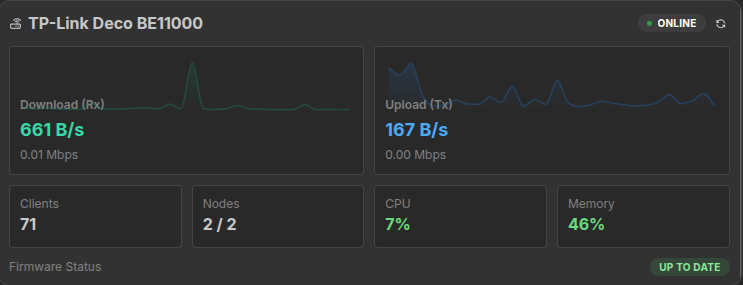
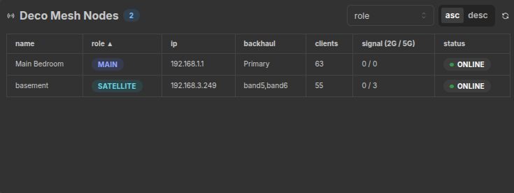
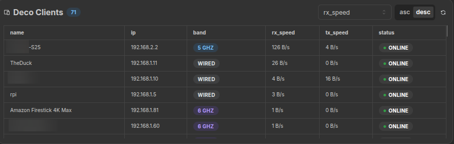

# Homarr v2 TP-Link Deco Widgets (Prometheus)

A suite of three custom widgets for **Homarr v2** built using the `homarr-custom-widget-v2` schema to monitor **TP-Link Deco** mesh routers (tested on **Deco BE11000** Wi-Fi 7) via **Prometheus** and your custom **`deco-exporter`** (`tplink-deco-api`).

## Included Widgets

| Widget | File | Purpose |
| :--- | :--- | :--- |
| **1. Internet & Bandwidth Overview** | [`deco-internet-overview-widget.json`](./deco-internet-overview-widget.json) | Dynamically displays your Deco model name, IPv4/IPv6 internet online status, live total Download/Upload speeds (`MB/s` + `Mbps`) with 5-minute (`10s` step) background sparkline charts, total connected clients, online mesh nodes, CPU/Memory load, and firmware update status. |
| **2. Connected Clients Table** | [`deco-clients-table-widget.json`](./deco-clients-table-widget.json) | Displays every connected client's `name`, `ip`, color-coded Wi-Fi `band` (`6 GHz`, `5 GHz`, `2.4 GHz`), live `rx_speed`, live `tx_speed`, and `status` (`Online`/`Offline`) at `14px` font with live + persistent sorting. |
| **3. Mesh Nodes Health Table** | [`deco-nodes-health-widget.json`](./deco-nodes-health-widget.json) | Displays each Deco unit's `name`, `role` (`Main` vs. `Satellite`), `ip`, `backhaul` bands, per-node `clients` count, `signal (2G / 5G)` strength, and `status` at `14px` font with live + persistent sorting. |

---

## Prerequisites

1. **Homarr v2** (with Custom Widgets v2 support).
2. **Prometheus** server reachable from your Homarr instance.
3. **Custom [`deco-exporter`](https://github.com/ksy23/deco-exporter) [(`tplink-deco-api`)](https://github.com/roquerodrigo/tplink-deco-api)** running on port **`7550`**.

---

## Step 1: Set Up `deco-exporter`

Deploy the multi-arch container image (`linux/amd64` and `linux/arm64`) via Docker Compose 

```yaml
services:
  deco_exporter:
    image: ghcr.io/ksy23/deco-exporter:latest
    container_name: deco_exporter
    ports:
      - "7550:7550"
    environment:
      DECO_HOST: "192.168.1.1"           # Main Deco gateway IP (do not include http://)
      DECO_USERNAME: "admin"             # Deco web UI username ("admin" or TP-Link ID email)
      DECO_PASSWORD: "your-tplink-password"
      POLL_INTERVAL: "30"
      METRICS_PORT: "7550"
      SPEED_MULTIPLIER: "125"            # Converts Kbps (BE11000 default) -> Bytes/s
    restart: unless-stopped
```

Start the container and verify metrics are exposed on port **`7550`**:
```bash
docker compose up -d
curl -s http://localhost:7550/metrics | grep ^deco_
```

---

## Step 2: Configure Prometheus Scrape Target

Add the `deco` scrape job to your `prometheus.yml` pointing to port **`7550`** and reload or restart Prometheus:

```yaml
scrape_configs:
  - job_name: 'deco'
    scrape_interval: 15s
    static_configs:
      - targets: ['<docker-host-ip>:7550']
```

---

## Step 3: Import Widgets into Homarr v2

1. Open Homarr and go to **Management → Custom Widgets**.
2. Click **Import** and upload each of the three `.json` files:
   * `deco-internet-overview-widget.json`
   * `deco-clients-table-widget.json`
   * `deco-nodes-health-widget.json`
3. For each imported widget, click **Actions (⋮) → Configure sources** and update `http://prometheus:9090` to your Prometheus server URL.
4. Enter **Edit Mode** on your Homarr dashboard, click **Add item → Widget**, and place the widgets on your board.

---

## Widget Options & Customization

### Persistent Sorting (Table Widgets)
For the **Connected Clients Table** and **Mesh Nodes Health Table**, use the dropdowns at the top of the widget for temporary sorting, or open the widget's settings while in board **Edit Mode** to save persistent defaults across page reloads:

| Widget | Option | Valid Values | Default |
| :--- | :--- | :--- | :--- |
| **Connected Clients** | `Default Sort Column` | `name`, `ip`, `connection_type`, `rx_speed`, `tx_speed`, `status` | `rx_speed` |
| **Connected Clients** | `Default Sort Order` | `asc`, `desc` | `desc` |
| **Mesh Nodes** | `Default Sort Column` | `name`, `role`, `ip`, `clients`, `status` | `role` |
| **Mesh Nodes** | `Default Sort Order` | `asc`, `desc` | `asc` |

### Adjusting Cache & Refresh Intervals
By default, **Widget 1** uses `cacheSeconds: 5` on live speed and status requests with a `5m:10s` sparkline subquery so speed test spikes appear quickly. To customize caching or refresh schedules, go to **Management → Custom Widgets → Edit → Requests** in Homarr's UI.

---

## Screenshots

### Deco Internet Overview


### Deco Nodes Health


### Deco Clients Table 


---