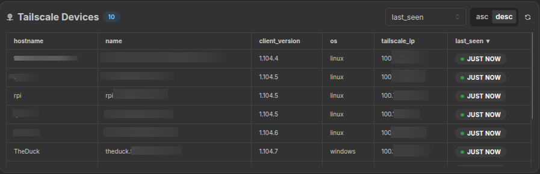

# Homarr v2 Tailscale Devices Info Widget (Prometheus)

A custom widget for **Homarr v2** that displays your Tailscale tailnet nodes—including `hostname`, `name`, `client_version`, `os`, `tailscale_ip`, and color-coded `last_seen` timestamps—queried directly from Prometheus.

## Features

* **Joined Tailscale Metrics:** Uses a PromQL `group_left` join to combine metadata from `tailscale_devices_info` with live check-in timestamps from `tailscale_devices_last_seen`.
* **Color-Coded `last_seen` Badges:**
  * 🟢 **Green (`Just now` / `< 5m ago`):** Actively online
  * 🟡 **Yellow (`5m – 1h ago`):** Recently active / idle
  * ⚪ **Gray (`> 1h ago` or `-`):** Offline or no timestamp available
* **Live & Persistent Sorting:** Includes interactive header dropdowns (`hostname`, `name`, `client_version`, `os`, `tailscale_ip`, `last_seen`) with natural numeric sorting (so IPs and versions order accurately) plus persistent board options.
* **Clean `14px` Table Layout:** Scrollable X/Y table sized for comfortable reading on desktop and mobile dashboards.

---

## Prerequisites

1. **Homarr v2** (with Custom Widgets v2 support).
2. **Prometheus** server reachable from your Homarr instance.
3. **[adinhodovic/tailscale-exporter](https://github.com/adinhodovic/tailscale-exporter)** scraping your Tailscale API and feeding metrics into Prometheus.

---

## Step 1: Configure `tailscale-exporter` & Prometheus

1. Deploy `adinhodovic/tailscale-exporter` with your Tailscale API credentials (`TAILSCALE_API_KEY` or OAuth client credentials and `TAILSCALE_TAILNET`). By default, it exposes metrics on port **`8080`** at `/metrics`.
2. Add the scrape job to your `prometheus.yml`:

```yaml
scrape_configs:
  - job_name: 'tailscale'
    static_configs:
      - targets: ['<tailscale-exporter-ip>:8080']
```

3. Reload or restart Prometheus and verify that `tailscale_devices_info` appears under **Status → Targets** and **Graph**.

---

## Step 2: Import into Homarr v2

1. Open Homarr and navigate to **Management → Custom Widgets**.
2. Click **Import** and upload `tailscale-devices-info-widget.json`.
3. On the Custom Widgets list, click **Actions (⋮) → Configure sources** on **Tailscale Devices Info (Table)** and change `http://prometheus:9090` to your Prometheus server URL.
4. Go to your dashboard, enter **Edit Mode**, click **Add item → Widget**, and select **Tailscale Devices Info (Table)**.

---

## Widget Options (Persistent Settings)

Open the widget's settings while in board **Edit Mode** to set your persistent defaults:

| Option | Description | Default |
| :--- | :--- | :--- |
| **Default Sort Column** | Column to sort by on load (`hostname`, `name`, `client_version`, `os`, `tailscale_ip`, `last_seen`) | `last_seen` |
| **Default Sort Order** | Sort direction on load (`asc` or `desc`) | `desc` |

---

## Screenshot



---

## Troubleshooting

* **`last_seen` shows `-` for all devices:** Depending on your exporter version or Tailscale API behavior, the `last_seen` metric may join on `name` or `hostname` instead of `id`. Open the widget's **Requests** tab in Homarr and update `on(id)` in the PromQL query to `on(name)` or `on(hostname)`.
* **Failed to query Prometheus:** Confirm your Prometheus source URL is accessible from the Homarr container and that **Network Scope** is set to `private` for local/LAN IPs.
